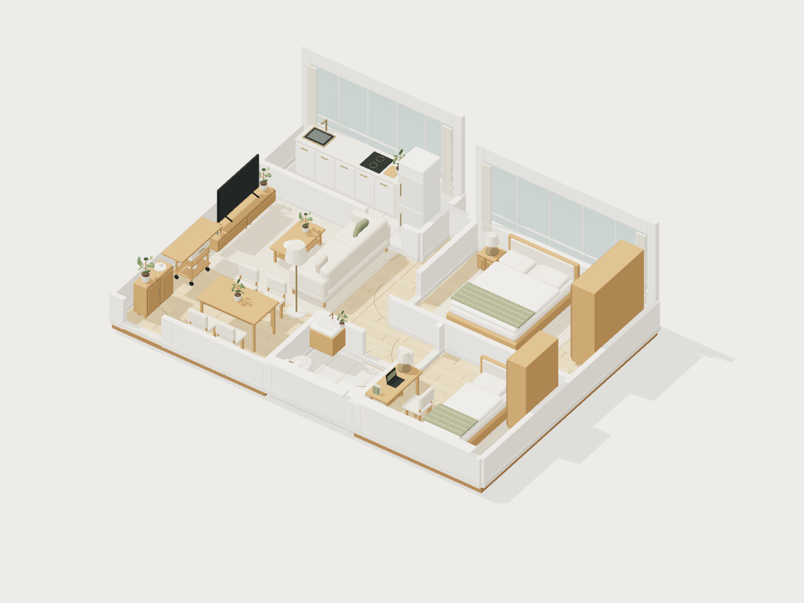

# ReNest HK

### Move what matters. Fit what works.

ReNest HK is a furniture reuse and spatial planning prototype for compact Hong Kong homes. It connects the decisions people make before a move: what to keep, how it fits in the next home, what to buy, and what to pass on.

The result is an interactive moving plan: compare furnished layouts, adjust individual pieces, review purchasing and reuse decisions, and export a practical handover report.

**[Open the interactive demo](https://renest-hk.vercel.app/)** · **[Technical architecture](docs/architecture.md)** · **[Product scope](docs/product-scope.md)**



*Illustrative apartment model from the bundled demo dataset. Layouts and furniture choices can be explored in the application.*

## Why it matters

A move starts before a shipment is booked. Households need to understand what is worth moving, what will fit, and which items need a different destination. ReNest brings those decisions into one visual workflow.

For a logistics evaluation, the prototype demonstrates how furniture identity, estimated dimensions, destination decisions and packing notes could inform a future moving-service handover. The present export is a user-reviewed report and CSV; carrier booking, freight quotation and FedEx API integration are future work.

## Review in five minutes

1. **[Open the interactive demo](https://renest-hk.vercel.app/).** Start with the old-home capture, select furniture, and choose the example new-home floor plan.
2. **Set the household brief.** Use quick preferences or the optional detailed questionnaire; compare three arrangements with different reuse, dining and workspace priorities.
3. **Test an actual edit.** Switch to Floor plan, move or rotate a piece, and inspect the updated arrangement, cost and report. Save the arrangement and reopen it from the homepage.
4. **Inspect the implementation.** Run the checks below and consult the [architecture](docs/architecture.md), [capability boundaries](docs/product-scope.md) and [repository audit](docs/repository-audit.md).

## What the prototype implements

| Capability | Implementation in this repository |
| --- | --- |
| Furniture inventory | 18 existing furniture groups with stable identifiers, estimated dimensions and keep/leave decisions. |
| Spatial planning | Three curated arrangements, ranked and adapted using deterministic household, budget and purchasing rules. |
| Interactive editing | Shared 2D/3D furniture placement, drag/nudge/rotate controls, and basic boundary, wall and footprint checks. |
| Decision support | Layout comparison, purchase estimates, furniture reuse counts and unmet-needs notices. |
| Moving handover | Downloadable CSV, PNG views and a printable report with furniture destinations and packing information. |
| Continuity | Versioned browser storage, up to 20 saved arrangements, and restoration of supported older saves. |
| Localisation | English, Simplified Chinese and Traditional Chinese, locally hosted fonts and reduced-motion support. |

**Demonstration boundaries.** Scanning and floor-plan reconstruction are simulated with bundled geometry. Uploaded files are validated or previewed locally; they do not reconstruct a home. Planning uses local rules and supplied layouts, with no live generative AI service. Catalogue prices and resale estimates are demo data. Resale drafts require manual publication. Door-swing clearance, accessibility, surveyed dimensions and real-world delivery feasibility require further validation.

## Run locally

Requirements: **Node.js 20.9 or later**, npm, and a modern browser with WebGL support. No API keys, database, account or Blender installation are required to run the application.

```bash
npm ci
npm run dev
```

Open [localhost:3000](http://localhost:3000). The main planning workflow is `/demo`.

For a production build:

```bash
npm run build
npm start
```

If local restrictions prevent Turbopack worker ports from opening, use `npm run dev -- --webpack` or `npm run build -- --webpack`.

## Engineering and verification

The application uses **Next.js 16 / React 19 / TypeScript** for routing and interaction, **Three.js** for spatial rendering, and **Tailwind CSS / CSS Modules / Framer Motion** for the interface. Exact dependency versions are recorded in `package-lock.json`.

```bash
npm run check
npm run build
```

`npm run check` generates Next.js route types, runs TypeScript, exercises the existing planning and geometry checks, and validates the delivery files against SHA-256 checksums. It also checks that delivery assets are not ignored and repository filenames use ASCII. These checks do not replace visual browser review or real-world spatial validation.

| Command | Purpose |
| --- | --- |
| `npm run typecheck` | Generate route types and check TypeScript. |
| `npm run check:studio` | Check save compatibility, planning rules, layout geometry and interior joinery. |
| `npm run check:delivery` | Verify delivery integrity, Git visibility and filename conventions. |
| `npm run build:refined-models` | Rebuild refined deployment models; requires Blender. |
| `npm run render:interior` | Render optional interior photographs; requires Blender. |

The former `next lint` command has been removed because it is unavailable in the installed Next.js version. A separate ESLint configuration is not currently included.

## Repository map

```text
app/                         Routes, layouts, page styles and local fonts
components/                  Shared UI, homepage and current moving studio
lib/                         Planning, geometry, persistence and localisation
types/                       Shared domain types
public/                      Assets served by the web application
assets/
  home-models/               Model sources, manifests and standalone viewer
  video-production/         Preserved final-film production source snapshot
deliverables/
  demo-film/                 Main film, English subtitles and verification
  presentation-clips/        Five short clips for presentation use
  manifest.json             Delivery file sizes and SHA-256 checksums
docs/                        Architecture, scope, design and engineering notes
  archive/                   Historical proposals and asset planning notes
scripts/                     Validation, asset generation and Blender tooling
output/                      Ignored local production workspace and scratch data
```

The model source and web deployment assets have separate responsibilities. `assets/home-models/` preserves editable source geometry and a standalone viewer; `public/models/v2/` contains the runtime assets, including refined versions. The `v2` path and furniture IDs are retained as compatibility identifiers.

## Data and deployment

User-selected room images and scan files are handled locally by the current application. Saved arrangements store planning data and source filenames, not the uploaded files. Browser storage is scoped to the current device, browser and origin; it is not a cloud backup. See [data handling and limitations](docs/product-scope.md).

The repository is configured as a standard Next.js project and the documented demo address is [renest-hk.vercel.app](https://renest-hk.vercel.app/). For deployment, use the repository root with the Next.js preset and `npm run build`. The delivery media live outside `public/` and are not served as application assets.

## Further reading

- [Delivery package](deliverables/README.md) — optional downloadable presentation assets and integrity checks.
- [Architecture](docs/architecture.md) — module ownership, data flow and asset pipeline.
- [Product scope](docs/product-scope.md) — implemented behaviour, simulations and roadmap.
- [Repository audit](docs/repository-audit.md) — naming decisions, removed legacy code and Git ignore policy.
- [Naming conventions](docs/naming-conventions.md) — file responsibilities, naming rules and compatibility exceptions.
- [Studio implementation](components/studio/README.md) — rendering and interaction notes.
- [Model source guide](assets/home-models/README.md) — source geometry, viewer and regeneration.
- [Third-party notices](docs/third-party-notices.md) — bundled licences.

This repository is a hackathon prototype prepared for technical evaluation. It does not claim a production carrier integration, measured operational savings or an implemented community pilot.
