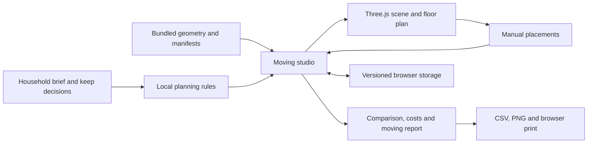

# Technical architecture

ReNest is a Next.js App Router application with a browser-based spatial planning workspace. The current prototype runs without an application database or external AI service.

## System flow

## Module ownership

| Area | Entry points | Responsibility |
| --- | --- | --- |
| Routes | `app/page.tsx`, `app/demo/page.tsx` | Homepage and canonical planning entry. Older workflow URLs redirect to `/demo`. |
| Workflow | `components/studio/moving-studio.tsx` | Current stage, selection, preferences, plan edits and result actions. |
| Rendering | `components/studio/home-scene.tsx`, `interior-scene.tsx` | Scene lifecycle, assets, interaction, lighting and interior views. |
| Planning | `lib/profile-planning.ts`, `living-profile.ts`, `living-brief.ts` | Validate user preferences and rank/adapt the three curated arrangements. |
| Spatial validation | `lib/studio-placement.ts`, `interior-joinery.ts` | Boundary, wall, footprint and rendering-joinery constraints. |
| Data contract | `lib/studio-data.ts`, `assets/home-models/data/` | Stable furniture IDs, layouts and save parsing. |
| Decision support | `lib/plan-insights.ts`, `components/studio/plan-comparison.tsx` | Counts, cost, reasons, alternatives and unresolved requirements. |
| Persistence | `components/studio/use-studio-history.ts`, `lib/studio-workspace.ts` | Saved plans, session continuity and recovery. |
| Reports | `components/studio/move-report.tsx`, `resale-list.tsx` | User-reviewed moving handover and resale preparation. |
| Localisation | `components/locale-provider.tsx`, `lib/*translations.ts` | English, Simplified Chinese and Traditional Chinese. |

The living profile and manual edits influence shared placements. The 3D view, comparison, pricing, exports and saved arrangements read those placements rather than maintaining separate layouts.

## Asset pipeline

1. `assets/home-models/src/generate.mjs` defines the original metric geometry and stable furniture identities.
2. `assets/home-models/models/` and `data/` preserve source models and manifests. The standalone viewer has its own local Three.js distribution and licence.
3. `scripts/refine-models.mjs` and `scripts/blender/` refine selected upholstery and validate bounds and metadata before writing runtime models.
4. `public/models/v2/` provides deployment GLBs; `public/films/interior/` provides optional pre-rendered interior views.

Some source and runtime files are byte-identical by design. Source geometry must remain available for rebuilding; the production models may contain additional refinement. Do not collapse these directories or rename furniture IDs without updating the data contract and saved-plan compatibility.

The first-generation scan model and its builder remain as separate asset provenance. The current studio uses the V2 home models. `lib/roomplan.ts` and `public/data/sample-roomplan.json` are a reference adapter and sample, not an active reconstruction service. `lib/interior-film-motion.ts` remains covered by the existing studio checks even though it is not an application entry point.

## Build and operational boundaries

- Model viewing and the application require no Blender installation; regeneration and offline rendering do.
- Fonts, maps and demonstration assets are local. No runtime AI, map-routing or marketplace integration is required.
- Source media production is separate from the web build. The video snapshot documents historical production logic, not a portable rendering pipeline.
- The public demo and separate deployment origins have independent browser storage.
- Read the installed Next.js guides under `node_modules/next/dist/docs/` before changing framework conventions.

See [product scope](product-scope.md) for user-data behaviour and [repository audit](repository-audit.md) for cleanup decisions.
